# Forgiven AI Commerce OS (FSC-OS)

<div align="center">


**The Autonomous, Multi-Tenant Commerce Operating System for Fashion & Lifestyle Enterprises**

[](https://www.typescriptlang.org/)
[](https://react.dev/)
[](https://vitejs.dev/)
[](https://supabase.com/)
[](https://tailwindcss.com/)
[](https://vitest.dev/)
[](https://deno.land/)
[]()

</div>

---

## 📌 Executive Summary

**Forgiven AI Commerce OS** is a production-grade, enterprise commerce operating system specifically engineered for modern fashion brands, multi-vendor marketplaces, and omni-channel retail networks. 

Built to eliminate the operational fragmentation of traditional commerce platforms, FSC-OS unifies:
1. **AI-Driven Visual Production & UGC Studio**: Automated product decomposition, virtual try-on (VTON), and studio-grade lifestyle campaign generation.
2. **Conversational WhatsApp Commerce**: End-to-end shopping, catalog queries, customer service, and instant checkout driven by AI directly in WhatsApp.
3. **Multi-Vendor Ecosystem**: Vendor portals, automated stock management, automated catalog sheet ingestion, and multi-vendor payout automation.
4. **Agent & Influencer Growth Engine**: Granular referral tracking (`?ref=CODE`), performance tiers, automated order attribution, and automated commission payouts.
5. **Autonomous Multi-Courier Logistics**: Unified dispatch routing, automated parcel booking, real-time tracking polling, and photographic delivery verification.
6. **FSC Document 3 Financial Intelligence**: Real-time margin calculation, automated markup distribution, dynamic pricing policies, and treasury reserve management.
7. **Enterprise Role-Based Access Control (v11)**: Executive staff positions, granular permission registries, multi-stage approval workflows, and immutable audit logs.

---

## 🏗️ System Architecture

```mermaid
flowchart TD
    subgraph ClientLayer["Omni-Channel Customer Touchpoints"]
        A1["Public Storefront (/shop)"]
        A2["WhatsApp Commerce Bot"]
        A3["Agent Referral Links (?ref=CODE)"]
        A4["Customer Tracking Portal (/tracking/:id)"]
    end

    subgraph EdgeGateway["Supabase Edge Functions (Deno Runtime)"]
        B1["whatsapp-webhook"]
        B2["create-payment (OneKhusa / PayChangu)"]
        B3["order-automation & pg_net"]
        B4["decompose-image & ugc-generate"]
        B5["logistics-orchestrator & impala-provider"]
        B6["smart-deliveries-create-parcel / sync"]
    end

    subgraph DatabaseLayer["PostgreSQL Engine (Supabase / RLS)"]
        C1[("Core Commerce\n(products, orders, customers)")]
        C2[("Vendor & Agent Engine\n(vendors, agents, commissions)")]
        C3[("Logistics & Couriers\n(courier_providers, delivery_orders)")]
        C4[("Enterprise RBAC v11\n(staff_positions, permissions, audit_logs)")]
        C5[("Intelligence & Pricing\n(pricing_policies, fund_allocations)")]
    end

    subgraph ExternalServices["External Cloud & API Infrastructure"]
        D1["AI Vision & VTON (Qwen-VL / Fal.ai / Photta)"]
        D2["Payments (OneKhusa / PayChangu / Mobile Money)"]
        D3["Telephony & Messaging (Twilio WhatsApp / SMS)"]
        D4["Couriers (Smart Deliveries MW / Impala)"]
        D5["Storage Buckets (ugc-assets / vendor-products)"]
    end

    ClientLayer --> EdgeGateway
    EdgeGateway --> DatabaseLayer
    EdgeGateway <--> ExternalServices
    DatabaseLayer <--> ExternalServices
```



---

## 💎 Core Pillars & Platform Capabilities

### 1. Flagship UGC & Studio Master Blueprint
* **Automated Decomposition**: The `decompose-image` edge function uses computer vision to strip raw vendor backgrounds, extract fashion garment silhouettes, and persist variant crops.
* **Deterministic Caching**: Decomposed images use deterministic SHA-256 cache keys (`decomposed/${cacheKey}_v${i}.png`) linked to `public.ugc_cache`, ensuring zero orphan file leakage upon retry.
* **Studio Master Blueprint (`studio.blueprint.ts`)**: Codified architectural rules defining camera positions (eye-level, low-angle hero), lighting setups (golden hour, soft daylight, editorial strobe), safe subject zones, and brand compliance rules.
* **Virtual Try-On (VTON)**: Orchestrates prompt generation and image-to-image synthesis using state-of-the-art vision models (Fal.ai, Photta, Qwen-VL) to render products onto dynamic avatar models.
* **Brand Asset Governance**: Injects official brand watermarks (`fsc-logo.png`) and architectural studio backgrounds (`fsc-flagship-studio.jpeg`) from the secured `ugc-assets` bucket.

### 2. Conversational WhatsApp Commerce
* **Automated Commerce Webhook (`whatsapp-webhook`)**: Inbound webhook processing customer messages via Twilio's WhatsApp Business API.
* **Natural Language Catalog Search**: Customers can browse products, request variations (colors, sizes), and receive rich product card images directly inside chat via `product-image-response`.
* **Instant Checkout Links**: Dynamically generates OneKhusa and PayChangu payment sessions tailored to the customer's cart.
* **Real-time Order Updates**: Triggered by database status changes via `pg_net`, notifying customers whenever an order transitions to `processing`, `shipped`, or `delivered`.

### 3. Multi-Vendor Marketplace & Portal
* **Vendor Portal (`/dashboard/vendor-portal`)**: Dedicated operational view for independent vendors to manage catalog listings, monitor incoming order dispatches, and track fulfillment metrics.
* **Automated Ingestion (`extract-catalog-sheet`)**: Automated parsing of bulk supplier spreadsheets into structured, review-ready product drafts.
* **Stock & Deduction Rules**: Configurable fixed vs. commission stock allocation, automated inventory decrements on paid transitions, and automatic vendor performance scoring.
* **Vendor Payout Automation (`paychangu-payout`)**: Automated ledger tracking vendor earnings and enabling direct bank or mobile money disbursement.

### 4. Agent & Influencer Network (Tiered Attribution)
* **Referral Tracking Engine (`?ref=CODE`)**: Captures agent codes in browser storage, preserving attribution through cart abandonment, navigation, and multi-session checkouts.
* **Tiered Commission Architecture**:
  * **Tier 1**: Baseline 8.00% commission on verified first orders.
  * **Tier 2 & 3**: Performance-driven escalations dynamically calculated by volume and customer retention triggers.
* **Agent Portal (`/dashboard/agent-portal`)**: Real-time referral analytics, earnings breakdown, withdrawal requests (`request_agent_payout`), and curated marketing collateral.

### 5. Autonomous Courier & Logistics Engine
* **Multi-Courier Support**: Built-in integrations for **Smart Deliveries MW** and **Impala Couriers**.
* **Automatic Waybill & Parcel Booking (`smart-deliveries-create-parcel`)**: Instant creation of delivery parcels and tracking numbers upon order confirmation.
* **Scheduled Status Polling (`sync-tracking-statuses` & `auto_sync`)**: `pg_cron` jobs continuously synchronize courier milestone events with internal customer tracking timelines (`/tracking/:orderId`).
* **Delivery Verification**: Drivers upload photographic proof of delivery and customer signatures directly to the `delivery-proofs` storage bucket.

### 6. FSC Document 3 Financial & Pricing Intelligence
* **Portfolio Financial Engine (`PortfolioFinancialEngine.ts`)**: Real-time algorithmic profit modeling for every SKU.
* **Deduction Stack Breakdown**:
  $$\text{Net Margin} = \text{Retail Price} - (\text{Vendor Cost} + \text{CAC Pool} + \text{Packaging} + \text{Logistics} + \text{Gateway Fee} + \text{Platform Fee} + \text{Tax})$$
* **Automated Markup Distribution**: Automatically allocates gross margins into 5 segregated accounts:
  1. **Operations Fund**
  2. **Owner Drawings**
  3. **Infrastructure & Cloud Tech**
  4. **Reinvestment Capital**
  5. **Emergency Treasury Reserve**
* **Policy Constraints & Margin Overrides**: Guardrails preventing sub-margin selling while allowing executive overrides through the approval engine.

### 7. Enterprise RBAC & Decision Intelligence (v11)
* **Executive Hierarchy (`staff_positions`)**:
  * **Managing Director**: Unrestricted executive authority across all domains.
  * **Operations & Systems Manager**: Warehouse, inventory, packaging, and logistics management.
  * **Finance & Administration Officer**: Treasury reserves, P&L statements, gateway allocations, and payout releases.
  * **Fulfillment Officer**: Pick/pack verification, dispatch labels, and courier handovers.
  * **Business Development Manager**: Vendor recruitment, growth pipelines, and promotional campaigns.
* **26+ Granular Permissions (`permissions`)**: Scoped by category (`Executive`, `Orders`, `Products`, `Pricing`, `Treasury`, `Finance`, `Payments`, `Inventory`, `Logistics`, `Staff`, `Audit`, `Decision Engine`).
* **High-Risk Approval Engine (`approval_requests`)**: Workflows for price overrides, emergency transfers, reserve withdrawals, and vendor exclusivity contracts.
* **Immutable Audit Ledger (`audit_logs`)**: Cryptographically identifiable actor records detailing actor position, permission invoked, module, before/after states, and IP telemetry.

---

## ⚡ Serverless Edge Functions (18 Deployed)

All edge functions run on Deno within Supabase's global edge network:

| Function Name | JWT Auth | Primary Role & Description |
|---|:---:|---|
| **`admin-create-user`** | `true` | Admin-initiated onboarding, role assignment, and Resend onboarding emails. |
| **`ai-generate`** | `true` | Vision-to-text generative copy, product summaries, and social media captions. |
| **`campaign-generate`** | `true` | Studio-grade marketing banner synthesis with official logo watermarking. |
| **`create-payment`** | `false` | Public checkout orchestrator for OneKhusa and PayChangu gateways. |
| **`decompose-image`** | `true` | AI garment extraction with deterministic SHA-256 caching. |
| **`extract-catalog-sheet`** | `true` | Ingestion engine converting supplier spreadsheets into catalog items. |
| **`firecrawl-products`** | `true` | Web scraping and automated product enrichment via Firecrawl API. |
| **`impala-provider`** | `true` | Logistics connector for Impala courier parcel booking. |
| **`logistics-orchestrator`** | `true` | Dynamic courier selection and dispatch lifecycle router. |
| **`order-automation`** | `true` | Real-time state machine for WhatsApp notifications and commission accrual. |
| **`paychangu-payout`** | `true` | Automated vendor and agent payout disbursements via Mobile Money/Bank. |
| **`product-image-response`** | `false` | Twilio WhatsApp media handler returning dynamic visual variations in chat. |
| **`smart-deliveries-create-parcel`**| `true` | Automated waybill creation connector for Smart Deliveries MW. |
| **`smart-deliveries-sync`** | `true` | Real-time tracking synchronization with Smart Deliveries MW network. |
| **`sync-catalog`** | `true` | Catalog sync engine executed every 5 minutes by `pg_cron`. |
| **`sync-tracking-statuses`** | `true` | Automated batch courier milestone polling for in-flight deliveries. |
| **`ugc-generate`** | `false` | Studio Master visual generator compiling multi-model generative pipelines. |
| **`whatsapp-webhook`** | `false` | Conversational commerce webhook receiving Twilio WhatsApp inbound traffic. |

---

## 🗄️ Database & Storage Architecture

### PostgreSQL Database
* **71 Sequential Migrations**: Tracking enterprise RBAC, multi-vendor splits, automated commissions, courier providers, and financial intelligence.
* **Row-Level Security (RLS)**: Enforced on 100% of public tables. Non-admin users are strictly scoped to their own records.
* **Asynchronous Webhooks (`pg_net`)**: Database triggers dispatch transactional webhooks to Edge Functions asynchronously without blocking client transactions.
* **Automated Cron Jobs (`pg_cron`)**: Schedules periodic background syncing (`sync-catalog-every-5-minutes`) directly inside PostgreSQL.

### Storage Buckets & Policies
1. **`ugc-assets` (Public)**: Studio master references (`brand/fsc-flagship-studio.jpeg`), brand logos (`brand/fsc-logo.png`), decomposed crops (`decomposed/`), master frames, and campaigns.
2. **`vendor-products` (Public)**: Raw and processed vendor catalog assets (`product_images/`).
3. **`avatars` (Public)**: Authenticated user profiles, agent avatars, and influencer model cards.
4. **`delivery-proofs` (Public)**: Courier signatures and photo proof of delivery.

### Storage Safeguard Engine
FSC-OS features a dedicated reference-aware storage auditor and cleanup engine:
* **`src/utils/storageSafeguards.ts`**: TypeScript library enforcing strict bucket boundaries, path validations, and reference checks.
* **`scripts/audit_storage.mjs`**: Audits storage objects against 8 database tables (`products`, `content`, `ugc_cache`, `influencers`, `profiles`, `orders`, `ugc_projects`, `ugc_frames`), categorizing assets into `REFERENCED`, `PROTECTED`, `CONFIRMED_ORPHAN`, or `POTENTIAL_ORPHAN`.
* **`scripts/cleanup_storage.mjs`**: Dry-run-first deletion planner requiring explicit CLI approval, running real-time database rechecks immediately before deletion.

---

## 📂 Repository Structure

```
forgivenai-commerce/
├── public/                       # Static public assets (favicons, logos)
├── scripts/                      # DevOps, audit, and storage automation utilities
│   ├── audit_storage.mjs         # Reference-aware storage audit script
│   ├── cleanup_storage.mjs       # Safe, dry-run-first storage cleanup engine
│   └── upload-studio.node.js     # Brand asset synchronization script
├── src/
│   ├── assets/                   # Bundled brand media and fallback images
│   ├── components/               # Modular UI components
│   │   ├── approvals/            # High-risk approval request dialogues
│   │   ├── audit/                # Immutable enterprise audit viewers
│   │   ├── dashboard/            # Specialized domain dashboards (agent, vendor, pricing)
│   │   ├── intelligence/         # Financial intelligence and margin indicators
│   │   ├── landing/              # Public marketing components
│   │   ├── layout/               # Navbars, sidebars, and application shell
│   │   ├── ugc/                  # Visual generation controls and variation selectors
│   │   └── ui/                   # Radix UI / shadcn/ui primitive library
│   ├── hooks/                    # Custom React hooks (auth, mobile, toast)
│   ├── integrations/supabase/    # Auto-generated Supabase typed client
│   ├── lib/                      # Utilities, formatters, and app mode detectors
│   ├── pages/                    # Core application pages and routes
│   │   ├── dashboard/            # Sub-pages (Products, Orders, Courier, Profit Intel, etc.)
│   │   ├── Auth.tsx              # Role-aware authentication portal
│   │   ├── CustomerTracking.tsx  # Public customer shipment tracking view
│   │   ├── Dashboard.tsx         # Enterprise operational shell
│   │   ├── Index.tsx             # Public landing page
│   │   ├── PaymentSuccess.tsx    # Payment callback verification view
│   │   └── Shop.tsx              # Public commerce storefront
│   ├── services/                 # Business logic and domain engines
│   │   ├── registries/           # Application, capability, and widget registries
│   │   ├── studio/               # Studio Master pipeline connectors
│   │   └── PortfolioFinancialEngine.ts # FSC Document 3 financial engine
│   ├── test/                     # Vitest unit & integration test suites
│   ├── types/                    # TypeScript interfaces (RBAC, Intelligence)
│   └── utils/                    # Storage safeguards and security helpers
├── supabase/
│   ├── config.toml               # Supabase project configuration and function routing
│   ├── functions/                # 18 Deno edge functions
│   └── migrations/               # 71 PostgreSQL migrations
├── .env.example                  # Environment variable blueprint
├── package.json                  # Dependencies and script definitions
├── tsconfig.json                 # Strict TypeScript configuration
└── vite.config.ts                # Vite build and test configuration
```

---

## 🛠️ Environment Configuration

Create a `.env` file in the project root:

```env
# ==============================================================================
# CLIENT-SIDE CONFIGURATION (Vite)
# ==============================================================================
VITE_SUPABASE_PROJECT_ID="your-project-ref"
VITE_SUPABASE_URL="https://your-project-ref.supabase.co"
VITE_SUPABASE_PUBLISHABLE_KEY="your-anon-key"

# ==============================================================================
# SERVER-SIDE & DEVOPS SECRETS (Never commit to version control)
# ==============================================================================
SUPABASE_ACCESS_TOKEN="sbp_xxxxxxxxxxxxxxxxxxxxxxxxxxxxxxxxxxxx"
SUPABASE_DB_PASSWORD="your-strong-db-password"
SUPABASE_SERVICE_ROLE_KEY="your-service-role-key"

# ==============================================================================
# THIRD-PARTY INTEGRATIONS (Used in Supabase Edge Functions Secrets)
# ==============================================================================
# Telephony & WhatsApp
TWILIO_ACCOUNT_SID="ACxxxxxxxxxxxxxxxxxxxxxxxxxxxxxxxx"
TWILIO_AUTH_TOKEN="xxxxxxxxxxxxxxxxxxxxxxxxxxxxxxxx"
TWILIO_WHATSAPP_NUMBER="whatsapp:+14155238886"

# Payment Gateways (Malawi / Regional)
PAYCHANGU_SECRET_KEY="sec_xxxxxxxxxxxxxxxx"
ONEKHUSA_API_KEY="xxxxxxxx"
ONEKHUSA_API_SECRET="xxxxxxxx"
ONEKHUSA_ORG_ID="xxxxxxxx"
ONEKHUSA_MERCHANT_ACCOUNT_NUMBER="xxxxxxxx"
ONEKHUSA_ENV="live" # or "test"

# AI Vision & UGC Generation
QWEN_API_KEY="sk-xxxxxxxxxxxxxxxxxxxxxxxx"
FAL_KEY="xxxxxxxx-xxxx-xxxx-xxxx-xxxxxxxxxxxx"
PHOTTA_API_KEY="xxxxxxxx"
ELEVENLABS_API_KEY="xxxxxxxx"
HF_TOKEN="hf_xxxxxxxxxxxxxxxx"

# Couriers & Logistics
SMART_DELIVERIES_API_KEY="xxxxxxxx"
SMART_DELIVERIES_BASE_URL="https://api.smartdeliveriesmw.com/v1"
IMPALA_API_KEY="impala_xxxxxxxx"

# Email Communications
RESEND_API_KEY="re_xxxxxxxx"
RESEND_FROM_EMAIL="Forgiven Shopping Centre <onboarding@forgiven.ai>"
PUBLIC_URL="https://forgiven.ai"
```

---

## 🚀 Local Development & Setup

### 1. Prerequisites
* [Node.js](https://nodejs.org/) `>= 20.x`
* [npm](https://www.npmjs.com/) `>= 10.x`
* [Supabase CLI](https://supabase.com/docs/guides/cli) `>= 2.75.x`

### 2. Installation
```bash
# Clone the repository
git clone https://github.com/forgivenai/forgivenai-commerce.git
cd forgivenai-commerce

# Install dependencies
npm install
```

### 3. Link Supabase Project & Push Database
```bash
# Authenticate Supabase CLI
export SUPABASE_ACCESS_TOKEN="your-access-token"

# Link to your Supabase project
supabase link --project-ref "your-project-ref"

# Push all 71 migrations to remote database
supabase db push

# (Optional) Verify migration diff
supabase db diff
```

### 4. Deploy Serverless Edge Functions
```bash
# Deploy all 18 functions to the remote project
supabase functions deploy --project-ref "your-project-ref"
```

### 5. Run the Local Development Server
```bash
npm run dev
```
The application will launch at `http://localhost:8080`.

---

## 🧪 Testing & Quality Assurance

FSC-OS maintains high code standards through comprehensive test suites:

```bash
# Run unit and integration tests (Vitest)
npm run test

# Run tests in watch mode
npm run test:watch

# Execute typechecking
npx tsc --noEmit

# Run production build validation
npm run build
```

### Current Test Coverage Highlights
* **`src/test/storageSafeguards.test.ts`**: 25 automated tests verifying path traversal prevention, protected file classification, folder boundaries, and orphan identification.
* **`src/test/backendPromptBuilder.test.ts`**: Validates dynamic prompt construction and studio blueprint directives.
* **`src/test/studioPipeline.test.ts`**: Tests the end-to-end UGC composition lifecycle.

---

## 🛡️ Production Safety & Governance

FSC-OS follows strict production safety rules:
1. **Zero SQL Deletes on Storage**: File removals must exclusively use the Supabase Storage API (`supabase.storage.from().remove()`) to preserve database and cloud storage synchronization. Direct SQL mutations on `storage.objects` are forbidden.
2. **Deterministic Artifact Caching**: All generated image variants derive paths from SHA-256 hashes of product data, preventing orphan accumulation across generation retries.
3. **Fail-Safe Cleanup Execution**: The cleanup planner requires explicit approval flags (`--execute-with-explicit-approval`) and re-queries live database tables immediately prior to deletion.
4. **Principle of Least Privilege**: Anonymous users can only view published items and submit public payment requests. All administrative actions require authenticated roles backed by enterprise RBAC.

---

## 📄 License & Intellectual Property

Copyright © 2026 Forgiven Shopping Centre & Forgiven AI. All rights reserved.  
Proprietary software — unauthorized reproduction, modification, or distribution is strictly prohibited.
